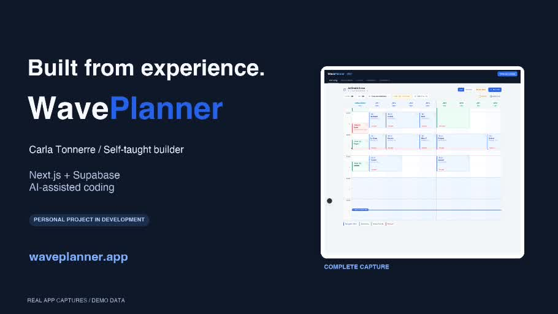

# WavePlanner

**Logiciel configurable de planning et de gestion pour les bases de jet-ski et les activités nautiques encadrées.**

[English presentation](README.md) · [Site du projet](https://waveplanner.app) · [Vidéo de présentation — 54 secondes](docs/media/waveplanner-demo.mp4)

WavePlanner réunit le planning, les réservations, les demandes en ligne, les ressources, les moniteurs, la caisse, les statistiques et le suivi estimé du carburant.

Le projet est né de mon expérience de monitrice de jet-ski, mais il est conçu pour être **configuré par chaque base selon son fonctionnement** : ses prestations, ses durées, ses prix, ses horaires, sa flotte et ses contraintes d'exploitation.

**État du projet : développement en cours, bêta privée sur invitation.** Le site de présentation est public. Les parcours clients en ligne sont actuellement limités au pilote autorisé ; leur présence dans le logiciel ne signifie pas une ouverture à toutes les bases pendant la bêta.

Ce dépôt contient la présentation publique et les médias de démonstration du projet. Le code source de l'application reste privé.

## Présentation vidéo

[Voir ou télécharger la vidéo MP4 — 54 secondes, environ 8 Mo](docs/media/waveplanner-demo.mp4)

La vidéo montre l'application avec des données de démonstration, ainsi qu'une capture en lecture seule de la recherche de créneau sur un compte connecté. Les montants affichés sont illustratifs.

## Captures de démonstration

### Planning et marées

### Caisse

## Une configuration propre à chaque base

Les activités et les chiffres visibles dans une capture sont un **exemple de configuration**, pas un catalogue ou des règles imposés à toutes les bases.

| Élément | Ce que la base peut configurer |
| --- | --- |
| Identité | Nom, coordonnées, localisation, site internet et lien d'avis Google. |
| Horaires | Jours ouverts ou fermés et heures d'ouverture et de fermeture pour chaque jour. |
| Flotte de jets | Ajout, nommage, modèle et activation des jets ; **jusqu'à 24 jets dans la version actuelle**. |
| Bateaux | Plusieurs bateaux, avec leur nom, leur moniteur et leur état actif. |
| Modèles de jets | Capacité du réservoir, réserve et seuil d'alerte carburant. |
| Moniteurs et groupes | Noms des groupes et moniteurs, affectation des jets et paramètres de capacité. |
| Prestations | Création, modification, activation et suppression d'activités sur jet ou bateau. |
| Durées et rotations | Durée de chaque prestation, marge après la sortie, marge supplémentaire et délai d'arrivée des clients. |
| Tarifs et affichage | Prix, nom court et couleurs de chaque activité. |
| Consommation | Consommation estimée par prestation et prix du carburant pour les indicateurs de marge. |
| Marées | Position du spot, fournisseur automatique ou saisie manuelle, fenêtres de blocage et activités concernées. |
| Demandes web | Activités proposées en ligne, identifiant du lien de la base, préavis et horizon de réservation. |

**Huit jets, deux groupes A/B, une ouverture à 09 h ou une durée donnée ne sont donc pas les limites générales de l'application.** Les valeurs initiales servent de point de départ et les captures illustrent une base configurée.

## Planning et exploitation

- Vues **jour et semaine**, avec départs, prestations et ressources affectées.
- Gestion des réservations sur un ou plusieurs jets et sur les bateaux configurés.
- Contrôle des disponibilités selon les horaires, les ressources actives, les maintenances, les groupes de moniteurs, les rotations et les contraintes de marée.
- Recherche de créneau avec propositions et alternatives expliquées : proximité de l'heure souhaitée, départ compatible existant et groupes mobilisés.
- Préremplissage du formulaire à partir d'une proposition ; la base valide l'enregistrement et la disponibilité est revérifiée.
- Notes par journée, indication des marées et du vent, coefficient indicatif avec correction manuelle.
- Déclaration de périodes d'indisponibilité d'un jet pour panne ou maintenance.

Le moteur aide à organiser les départs. La décision d'exploitation et de sécurité reste à la base.

## Réservation en ligne et suivi client

Le parcours web fait partie de l'application. Il complète la saisie des réservations par l'équipe :

1. La base choisit les prestations encadrées proposées en ligne et configure son lien personnalisé `/r/<identifiant-base>`, partageable par **QR code**.
2. Le client choisit une prestation, le nombre de jets, une date et une période disponible, puis renseigne ses coordonnées et les informations demandées.
3. La demande arrive dans l'application. L'équipe peut la refuser ou la placer dans le planning en choisissant l'heure exacte et les ressources.
4. Si un paiement de confirmation est requis, le parcours prévoit Stripe Connect avec le compte de la base. Une réservation en attente d'acompte bloque les ressources sans être comptée comme déjà acceptée ; la confirmation dépend du paiement.
5. Le client dispose d'une page de suivi par lien dédié : état de sa demande, offre proposée, informations contractuelles et annulation selon le parcours prévu. Les confirmations et annulations disposent d'emails transactionnels.

La demande web n'est pas une réservation automatiquement confirmée. Les paramètres de paiement et les informations de la base sont contrôlés avant le passage au paiement.

**Disponibilité actuelle :** pendant la bêta privée, ces parcours sont réservés au pilote explicitement autorisé. Les rappels SMS clients et les alertes SMS métier sont suspendus. Les fonctions de paiement restent soumises au protocole de validation pilote.

## Réservations et relation client

- Création et modification manuelles depuis le planning ou le formulaire de réservation.
- Liste des réservations, recherche et filtres.
- Coordonnées, notes, statut d'arrivée et suivi du paiement.
- Fiche client avec historique et répartition des activités.
- Gestion des demandes web en attente dans l'interface de l'équipe.

## Caisse et statistiques

- Récapitulatifs par **jour, semaine, mois et année**.
- Suivi du chiffre d'affaires, des encaissements, des restes à payer et des modes de paiement.
- Bons cadeaux identifiés séparément des montants réellement encaissés.
- Export **CSV**.
- Statistiques annuelles : évolution mensuelle et comparaison avec l'année précédente lorsqu'elle contient des données, répartition par prestation, jours et heures de départ, principaux clients.
- Indicateurs de marge après coût estimé du carburant, calculés à partir des consommations et du prix au litre configurés ; ils ne représentent pas un bénéfice net comptable.

## Carburant et flotte

- Estimation des niveaux de carburant par jet et modèle.
- Réserve, seuils d'alerte et saisie des ravitaillements.
- Prise en compte des sorties et consommations configurées pour anticiper les besoins.
- Indisponibilités de maintenance prises en compte dans les disponibilités.

Les niveaux sont des estimations issues des paramètres et des opérations enregistrées, pas des mesures transmises par un capteur.

## Équipe, langues et données

- Comptes propriétaire et membres rattachés à la base.
- Rôles **manager**, **staff** et **lecture seule**, avec droits appliqués côté serveur.
- Interface en **français, anglais et espagnol**.
- Application installable en **PWA**.
- Authentification et persistance serveur avec Supabase.
- Caches locaux, indicateur de synchronisation et détection des conflits entre appareils.

## Projet et technologies

Je suis **Carla Tonnerre**, monitrice de jet-ski et autodidacte. Je développe WavePlanner avec l'aide d'outils d'IA, en travaillant sur les parcours métier, la clarté de l'interface et la vérification du comportement de l'application.

| Couche | Technologies |
| --- | --- |
| Application | Next.js 15 App Router, React 19, TypeScript 5 |
| Interface | Tailwind CSS, shadcn/ui |
| Authentification et données | Supabase Auth, stockage serveur et routes API |
| Paiements | Stripe et Stripe Connect, dans le périmètre de la bêta et du pilote |
| Communications | Intégrations Brevo, avec les restrictions SMS indiquées ci-dessus |
| Marées et météo | Intégrations Stormglass côté serveur et paramètres de marée manuels |
| Qualité | ESLint, TypeScript, Vitest, Playwright et GitHub Actions |
