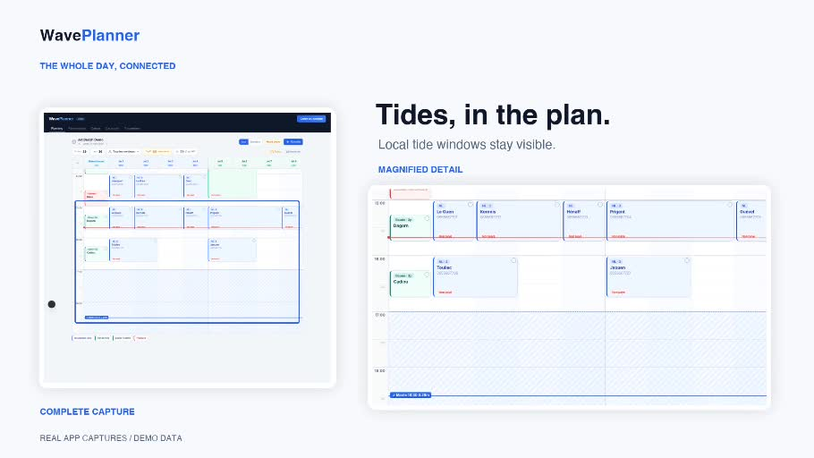
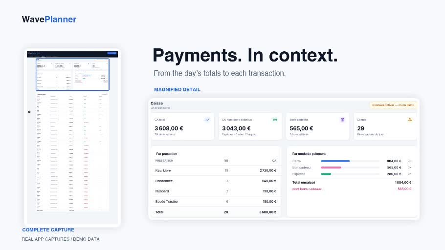

# WavePlanner

**Configurable planning and operations software for jet-ski bases and guided watersports activities.**

[Présentation française](README.fr.md) · [Product website](https://waveplanner.app) · [54-second walkthrough](#video-walkthrough)

WavePlanner connects the planning board, reservations, online requests, resources, instructor groups, daily takings, statistics and estimated fuel levels.

The project grew out of my work as a jet-ski instructor. It is designed for **each base to configure its own operations**, including activities, durations, prices, opening hours, fleet and operating constraints.

**Status: personal project in development, invitation-only private beta.** The product website is public. Customer-facing booking flows are currently restricted to the authorised pilot.

This repository contains the public project presentation and demonstration media. The application source code is kept private.

## Video walkthrough

https://github.com/user-attachments/assets/61be4a07-5cfb-4be6-9fcf-1eb72982d251

[Download the original MP4 — 54 seconds, about 8 MB](https://github.com/cato104/WavePlanner-showcase/raw/refs/heads/main/docs/media/waveplanner-demo.mp4)

The video uses application captures and labelled demonstration data, including a read-only slot-finder capture in a signed-in account. All figures shown are illustrative.

## Demonstration screenshots

### Planning and tide windows

### Daily takings

## Configuration belongs to the base

The activities and figures visible in a screenshot are examples, not a fixed catalogue for every base.

| Area | Configurable scope |
| --- | --- |
| Base details | Name, contact details, location, website and Google review link. |
| Opening hours | Open/closed days and opening and closing times for each day. |
| Jet fleet | Add, name, assign models and enable jets — **up to 24 jets in the current version**. |
| Boats | Multiple boats with their names, instructors and active status. |
| Jet models | Tank capacity, reserve and fuel warning levels. |
| Instructor groups | Names, jet assignments and capacity settings. |
| Activities | Create, edit, enable and remove activities using jet or boat resources. |
| Timing | Per-activity duration, turnaround buffer, extra buffer and customer arrival lead time. |
| Prices and display | Per-activity prices, short names and colours. |
| Fuel | Estimated consumption per activity and fuel price for margin indicators. |
| Tides | Spot coordinates, automatic provider or manual input, blocking windows and affected activities. |
| Online requests | Activities offered online, the base's URL identifier, minimum notice and booking horizon. |

Eight jets, two A/B groups, a 09:00 opening time or a particular activity duration are example/default values, not general limits imposed on all bases.

## Planning and operations

- Day and week views, multi-jet reservations and configured boat resources.
- Availability checks covering opening hours, active resources, maintenance, instructor groups, rotations and tide constraints.
- Slot suggestions and explained alternatives around the requested time, existing compatible departures and instructor groups involved.
- A suggestion prefills the reservation form; the team confirms the save and availability is checked again.
- Daily notes, tide and wind information, an indicative tide coefficient with manual override.
- Date-based jet maintenance and breakdown unavailability.

The base keeps the final operational and safety decision.

## Online booking and customer follow-up

1. The base selects the supervised activities offered online and configures its personalised `/r/<base-identifier>` page, shareable by QR code.
2. The customer chooses an activity, number of jets, date and available period, then enters the required contact details and information.
3. The request appears in the team's application. The team can refuse it or select an exact departure time and resources in the planning board.
4. Where confirmation payment is required, the flow uses the base's Stripe Connect account. A request awaiting a deposit holds resources without counting as already accepted; confirmation depends on payment.
5. A dedicated customer link provides request status, the proposed offer, contractual information and the supported cancellation flow. Transactional emails cover confirmation and cancellation.

An online request is not an automatically confirmed booking. Payment configuration and base information are checked before checkout.

**Current availability:** these customer workflows are limited to the explicitly authorised pilot during the private beta. Business SMS alerts and customer SMS reminders are paused. Payment validation follows the pilot validation process.

## Reservations, daily takings and statistics

- Manual reservation creation and editing, searchable lists and filters.
- Customer details, notes, arrival status and payment tracking.
- Customer history and activity breakdowns.
- Daily, weekly, monthly and yearly cash summaries and CSV export.
- Revenue, collected amounts, outstanding balances and payment methods; gift vouchers shown separately from money collected.
- Annual statistics, monthly trends and prior-year comparisons where data exists, activity breakdowns, departure days/times and top customers.
- Margin indicators after estimated fuel cost using configured consumption and fuel price, rather than net accounting profit.

## Fleet and fuel

- Estimated fuel levels for each jet and model, reserve and warning thresholds.
- Recorded refuelling and configured activity consumption to anticipate needs.
- Maintenance periods incorporated into availability.

Fuel levels are estimates derived from configuration and recorded operations, rather than sensor readings.

## Team, languages and data

- Owner accounts and members attached to a base.
- Manager, staff and read-only roles, enforced on the server.
- French, English and Spanish interfaces.
- Installable PWA.
- Supabase authentication and server-side persistence.
- Local caches, visible synchronisation status and conflict handling across devices.

## About the project

I am **Carla Tonnerre**, a jet-ski instructor and self-taught builder. I am developing WavePlanner using AI-assisted coding, focusing on practical workflows, interface clarity and checking the application's behaviour.

| Layer | Technology |
| --- | --- |
| Application | Next.js 15 App Router, React 19, TypeScript 5 |
| Interface | Tailwind CSS and shadcn/ui |
| Authentication and data | Supabase Auth, server-side storage and API routes |
| Payments | Stripe and Stripe Connect within beta/pilot restrictions |
| Communications | Brevo integrations, subject to the SMS restrictions above |
| Tides and weather | Server-side Stormglass integrations and manual tide settings |
| Quality | ESLint, TypeScript, Vitest, Playwright and GitHub Actions |
